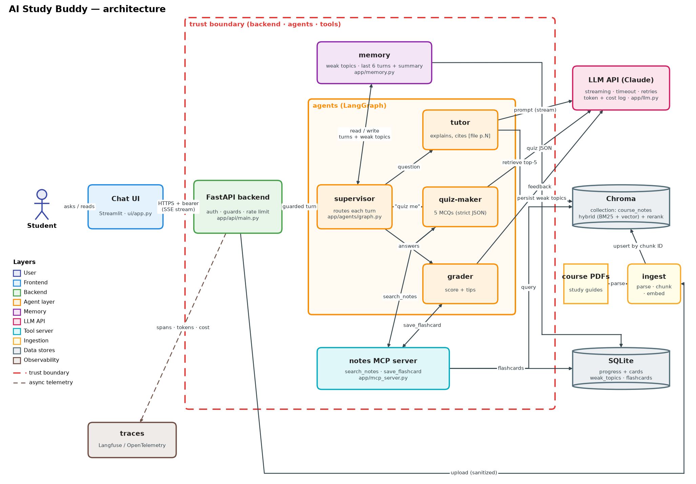

# AI Study Buddy

A tutor that answers from your course PDFs **with citations**, **quizzes you**, and **remembers your weak topics**.

| What it does | How |
|---|---|
| **Ask with citations** | Writes the full answer in the chat (a direct answer + key points), every line ending with its file + page, e.g. `[Day_22_23_AI_Security_Visual_Notes.pdf p.10]`. Under each answer, **📄 Read the source pages** shows the note text of every cited page. Anything outside the notes gets *"That's not in my notes."* |
| **Quiz me** | 5 multiple-choice questions on a topic (strict JSON), graded with score + feedback |
| **Track weak topics** | Missed questions update per-student weak topics in SQLite; *"quiz me"* in a later session picks the weakest one |
| **Add new notes** | Upload a PDF in the UI → sanitized, chunked, embedded, searchable (private to you) |



Source: [`docs/architecture.drawio`](docs/architecture.drawio) (open in draw.io / diagrams.net). Both files are generated from one spec, `scripts/build_diagram.py`. `tests/test_diagram.py` checks that every component is present, every arrow is labelled, and every file the diagram names exists.

---

## Run it

### Docker (all services)

```bash
cp .env.example .env            # add ANTHROPIC_API_KEY (optional, see "Offline mode")
docker compose up --build       # chroma + api + ui
```

- UI: http://localhost:8501 (demo tokens `alice-token` and `bob-token`)
- API: http://localhost:8080/docs
- Optional trace viewer: `OTEL_EXPORTER_OTLP_ENDPOINT=http://jaeger:4318 docker compose --profile observability up`, then open http://localhost:16686

On first start the API ingests `data/pdfs/*.pdf` into Chroma's `course_notes` collection.

### Local (no Docker)

```bash
uv venv .venv && source .venv/bin/activate          # or python -m venv
pip install --index-url https://download.pytorch.org/whl/cpu torch
pip install -r requirements.txt
python -m app.ingest --reset                         # parse · chunk · embed → data/chroma
uvicorn app.api.main:app --port 8080                 # backend
streamlit run ui/app.py                              # UI on :8501
python -m app.mcp_server                             # notes MCP server (stdio)
```

### Offline mode

With no `ANTHROPIC_API_KEY` (or `LLM_OFFLINE=1`) the whole app still runs. The LLM wrapper falls back to deterministic stubs, and tests and CI use this mode, so they need no secrets:

- **Answers (`app/answer.py`):** composed from the notes. The top passages are split into sentences, "Term: meaning" items and Q/A flashcards. Each is scored against the question (cross-encoder + embeddings), and the tutor writes a lead answer plus key points. Steps stay in page order for "stages / steps / becomes" questions, and every line is cited.
- **Quizzes:** built from the notes' own flashcards and definitions; wrong options are answers to other questions in the notes.
- **Rewrite, summary and grading:** rule-based.

Set the key to get Claude-written explanations (`LLM_MODEL`, default `claude-sonnet-5-5`). The same citation rules and source panel apply.

Ingestion rebuilds readable lines from the PDF layout (`app/ingest/layout.py`). It joins wrapped sentences (including centred captions that the PDF splits into blocks), attaches labels to their text (`ENTRY` + "hostile content arrives…", or a bold term on the same row as its definition), and keeps reading order. This is why answers and source passages read as full sentences.

### Try it

```
What is memory poisoning?
explain that again                 ← follow-up rewritten to the full question
quiz me on prompt injection        ← 5 MCQs; answer with the form or "A C B D A"
quiz me                            ← next session: picks your weakest topic
how am I doing?   ·   save a flashcard for golden dataset   ·   show my flashcards
What is the capital of France?     ← "That's not in my notes."
```

---

## The 15 features

| # | Feature | Where | What was built |
|---|---|---|---|
| 1 | Prompt design | `app/prompts.py` | Tutor answers only from `<notes>`, cites `[file p.N]`, otherwise says *"not in my notes"*; quiz prompt + JSON schema (question, 4 options, answer, explanation, source) |
| 2 | LLM API layer | `app/llm.py` | One wrapper: streaming, timeout, 2 retries with exponential backoff and jitter, tokens and cost logged per request (`logs/llm_usage.jsonl` + span attributes), server-side refusal fallback |
| 3 | Ingestion | `app/ingest/pdf_loader.py` | Page-by-page text with metadata **file, day, page, heading** (+ topic); running headers removed; optional `data/pdfs/manifest.json` for day ranges |
| 4 | Chunking | `app/ingest/chunker.py` | Heading-aware, about 500 tokens, 60-token prose overlap; **lists and tables are atomic**; never crosses a page |
| 5 | Embeddings | `app/ingest/embedder.py` | One model (`all-MiniLM-L6-v2`); `embed_model` stored on every vector and on the collection; a model mismatch raises `ReindexRequired` |
| 6 | Vector DB | `app/vector_store.py` | Chroma `course_notes`, cosine; filters `day`, `topic`, `owner`; **upsert by deterministic chunk ID** + stale-chunk cleanup |
| 7 | RAG + citations | `app/rag.py`, `app/answer.py` | Top-5 → full cited answer (lead + key points, `[file p.N]` on every line) + the cited passages returned as `sources` for the UI; refuses below the threshold (two signals: rerank ≥ 0.25, or rerank ≥ 0.03 with vector ≥ 0.45); citations checked against the retrieved set |
| 8 | Advanced retrieval | `app/retrieval/` | BM25 + vector → RRF → cross-encoder rerank (`ms-marco-MiniLM-L-6-v2`); follow-up rewrite (`explain that again` → full question) |
| 9 | Tool-calling agent | `app/agents/tools.py` | Typed (pydantic) tools `search_notes`, `make_quiz`, `save_flashcard`, `get_progress`; `student_id` comes from auth context, never from tool args; Claude tool loop capped at 4 steps |
| 10 | Multi-agent flow | `app/agents/graph.py` | LangGraph: `load_memory → supervisor → tutor \| quiz_maker \| grader \| tools → save_memory`; grader returns score + feedback |
| 11 | MCP | `app/mcp_server.py`, [`docs/mcp.md`](docs/mcp.md) | `search_notes` + `save_flashcard` over MCP (stdio / streamable HTTP); tested with MCP Inspector CLI and a Python MCP client (`tests/test_mcp.py`); desktop-client config in docs |
| 12 | Memory | `app/memory.py` | Short-term: last 6 turns + running summary; long-term: `weak_topics` in SQLite, used to pick the next quiz |
| 13 | Security guardrails | `app/guards.py`, `app/ingest/sanitize.py` | Uploads are untrusted: tiny, transparent, off-page and low-contrast text dropped, plus instruction-like lines; uploads are owner-scoped; bearer auth; per-student rate limit; message, upload and page limits; quiz answers never sent to the client |
| 14 | Tests + evaluation | `tests/`, `eval/` | 30-question golden set (+6 off-topic); recall@5, MRR, faithfulness, citation and refusal metrics; unit tests for the chunker and quiz JSON parser (+ guards, API, MCP, diagram) |
| 15 | Deploy + observe | `Dockerfile`, `docker-compose.yml`, `.github/workflows/ci.yml`, `app/observability.py` | Compose (api, ui, Chroma, optional Jaeger); CI runs tests + eval gate + `docker compose up`; an OpenTelemetry span for every request (JSONL locally, Langfuse or OTLP when configured), `x-trace-id` header |

## Evaluation results

`python -m eval.run_eval --gate` (offline mode, 207 chunks; full report in [`eval/report.md`](eval/report.md)):

| Metric | Result | Gate |
|---|---|---|
| **recall@5** (gold page in top 5) | **1.000** | ≥ 0.80 ✅ |
| strict recall@5 / MRR@5 | 0.828 / 0.983 | — |
| citation rate (answers citing file + page) | 1.000 | = 1.00 ✅ |
| citation validity (cited page was retrieved) | 1.000 | — |
| faithfulness (claims supported by cited notes) | 1.000* | ≥ 0.80 ✅ |
| off-topic → "not in my notes" | 6 / 6 | = 1.00 ✅ |
| false refusals on answerable questions | 0 / 30 | — |

Retrieval ablation (strict recall@5 / MRR@5): vector only 0.772 / 0.889 → hybrid 0.850 / 1.000 → hybrid + rerank 0.828 / 0.983. Hybrid search is the big gain. On this golden set the reranker's own contribution is small (it slightly lowers strict recall), but its score is what powers the "not in my notes" refusal gate.

Caveats: gold pages were labelled from the PDF text, not from retriever output. The refusal thresholds were tuned on this set plus about 25 off-topic probes, so the refusal numbers are optimistic. \*Offline answers quote the notes, so word-overlap faithfulness is close to 1 by construction. The meaningful faithfulness check is Claude answers judged by Claude: set the API key and run `--judge`.

## Acceptance criteria

| Criterion | Evidence |
|---|---|
| ✅ every answer cites file + page | citation rate 1.000; `test_answer_cites_file_and_page`; `enforce_citations` |
| ✅ off-topic → "not in my notes" | refusal accuracy 6/6; `test_off_topic_is_not_in_my_notes` |
| ✅ quiz JSON always parses | structured output + tolerant parser + offline top-up; `tests/test_quiz_parser.py` |
| ✅ weak topic returns next session | `test_quiz_then_grade_then_weak_topic_next_session` |
| ✅ MCP tool works from a client | `tests/test_mcp.py`, MCP Inspector CLI (see `docs/mcp.md`) |
| ✅ recall@5 ≥ 0.8 on golden set | 1.000 (CI gate) |
| ✅ `docker compose up` starts all | CI `docker` job (`--wait` on health checks + a cited answer) |
| ✅ diagram matches the code | `tests/test_diagram.py` + CI diff check of `docs/architecture.drawio` |

## Project layout

```
app/
  api/main.py          FastAPI: auth · guards · rate limit · SSE · traces
  agents/graph.py      LangGraph supervisor → tutor | quiz-maker | grader | tools
  agents/{quiz,grader,tools}.py
  ingest/              pdf_loader · layout (readable lines) · sanitize · chunker · embedder · pipeline
  retrieval/           vector · hybrid (BM25+RRF+rerank) · rewrite
  rag.py answer.py     cited answers (+ no-LLM answer composer) · source passages
  prompts.py llm.py memory.py db.py guards.py vector_store.py observability.py mcp_server.py
ui/app.py              Streamlit chat UI
eval/                  golden_set.jsonl · run_eval.py · report.md
tests/                 chunker · quiz parser · guards · api · mcp · diagram
docs/                  architecture.drawio/.png · mcp.md
```

## Configuration

See [`.env.example`](.env.example). Change `API_TOKENS` (format `student:token,...`) before any shared deployment; the demo tokens are public.

Citations use PDF page indices, which are what a PDF viewer shows. The handbook's printed page numbers are offset by 1.
